# 📦 StockPile — Cloud-Native Inventory Platform on AWS EKS

[](https://github.com/Shaikh-Suja-Rahaman/stockpile-DevOps-Project/actions/workflows/ci-cd.yml)


**StockPile** is an enterprise-grade, cloud-native inventory management SaaS application designed to demonstrate the complete **DevSecOps lifecycle**: from developer commit to automated testing, security scanning, container packaging, infrastructure provisioning with Terraform, deployment on Kubernetes with Helm & ArgoCD GitOps, autoscaling with HPA, and real-time monitoring with Prometheus and Grafana.

---

## 1. Architecture Overview

```text
 Developer ──git push──▶ GitHub Repository (main)
                             │
                             ▼
               GitHub Actions CI/CD Pipeline
    ┌─────────────────────────────────────────────────────────────┐
    │ 1. Quality Gates   Jest Unit Tests (24/24) · Vite Build     │
    │                    IaC Validate (Terraform & Helm Lint)     │
    │ 2. Security Gate   Docker Multi-Stage Build                 │
    │                    Trivy Container Scan (0 HIGH/CRITICAL)   │
    │                    Push to GHCR (Tagged with Commit SHA)    │
    │ 3. GitOps Trigger  Bump Image Tag in values-prod.yaml       │
    └─────────────────────────────────────────────────────────────┘
                             │ (Commit by CI Bot)
                             ▼
    Terraform ──▶ AWS VPC (2 Public + 2 Private Subnets, NAT GW)
                    └─ AWS EKS Cluster (v1.34, 2x t3.large Nodes)
                         │
                 ArgoCD GitOps Operator (Auto-Sync & Self-Heal)
                         │
           ┌─────────────┴──────────────────────────────┐
           │ Namespace: stockpile                       │
           │                                            │
   Internet ─▶ Ingress-Nginx (AWS ELB Load Balancer)    │
           │      ├── /api ──▶ Backend Service (Node) ──▶ Express Pods (HPA 2–6)
           │      └── /    ──▶ Frontend Service       ──▶ Nginx + React Pods
           │                        Backend ──▶ PostgreSQL StatefulSet (EBS gp3)
           └────────────────────────────────────────────┘
                         │ Scrape /metrics (ServiceMonitor)
                         ▼
           Prometheus ──▶ Grafana Dashboard ("StockPile API")
```

---

## 2. Tech Stack

| Layer | Technology | Purpose |
| :--- | :--- | :--- |
| **Frontend** | React 19 + Vite | Responsive inventory dashboard with KPI metrics, filters, and modal editor |
| **Backend** | Node.js 22 + Express 5 | RESTful API, validation, Knex ORM migrations, Helmet security headers |
| **Database** | PostgreSQL 16 | ACID-compliant relational storage with idempotent seeding and integer cent pricing |
| **Testing** | Jest 30 + Supertest + pg-mem | In-memory isolated database tests; zero external dependencies |
| **Security** | Trivy + Helmet + Non-root | Strict container security scanning, no root execution, read-only root filesystems |
| **CI/CD** | GitHub Actions | Automated build, test, scan, and push pipeline triggered on branch pushes |
| **Registry** | GitHub Container Registry (GHCR) | Immutable container image storage tagged with Git commit SHAs |
| **IaC** | Terraform | Reusable modules provisioning AWS VPC, Subnets, NAT Gateway, IAM roles, and EKS |
| **Orchestration** | AWS EKS (Kubernetes 1.34) | Production container management with EBS CSI storage driver |
| **Packaging** | Helm | Parametrized Kubernetes manifests (`values-dev.yaml`, `values-prod.yaml`) |
| **GitOps** | ArgoCD | Declarative continuous delivery with automated synchronization and drift correction |
| **Autoscaling** | Metrics Server + HPA | Horizontal Pod Autoscaler scaling backend pods dynamically between 2 and 6 replicas |
| **Observability** | Prometheus + Grafana | Prometheus Operator metrics scraping (`/metrics`) and custom visual dashboards |

---

## 3. Rubric Verification & Screenshots

All verification evidence is captured directly from the live deployment and stored in [`demo/screenshots/`](demo/screenshots/).

### 3.1 Local Development & Quality Gates (M1, M2, M4)

| Milestone Verification | Screenshot Evidence |
| :--- | :--- |
| **SS-01: Automated Tests Passing**<br>24/24 Jest unit tests passing across all endpoints, validations, and database migrations. | 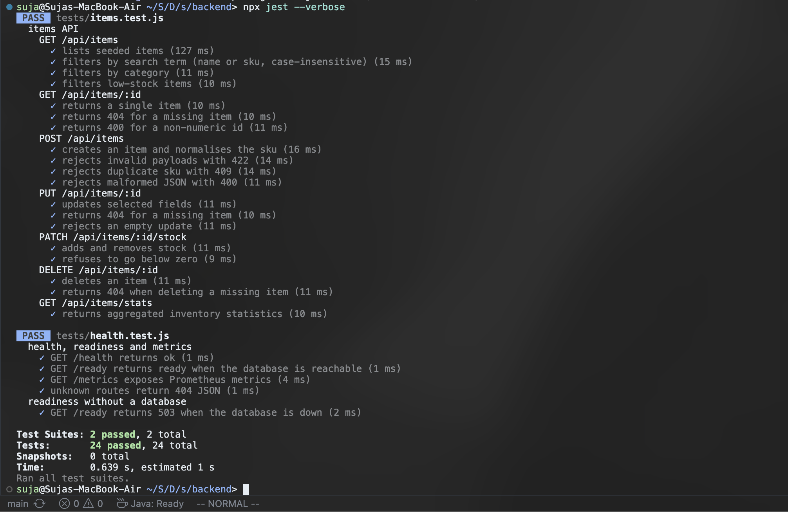 |
| **SS-02: Docker Compose Full Stack**<br>Three non-root containers (`postgres`, `backend`, `frontend`) running locally with migrations applied. | 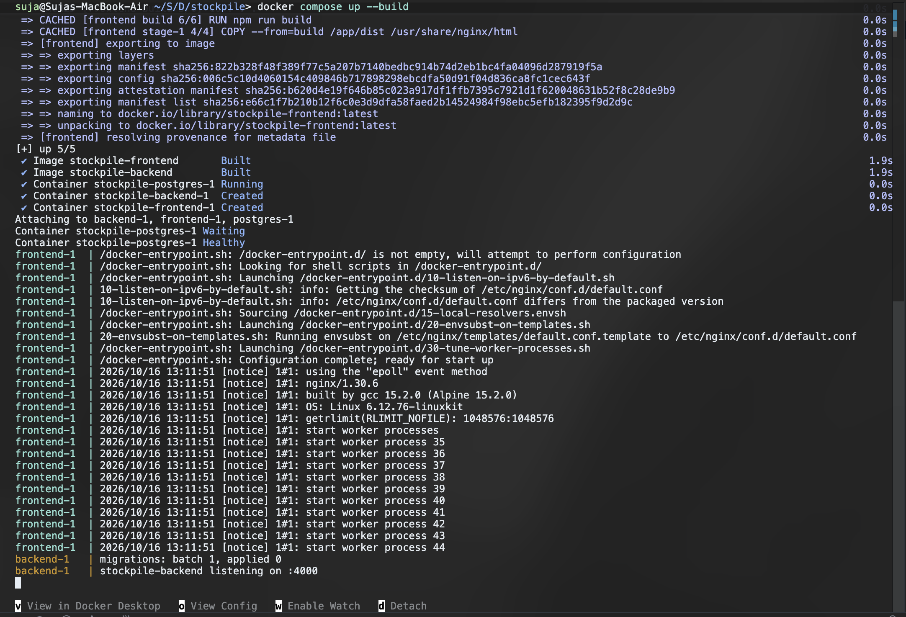 |
| **SS-03: StockPile Dashboard UI**<br>Frontend dashboard at `http://localhost:3000` with KPI cards, low-stock indicators, and search. | 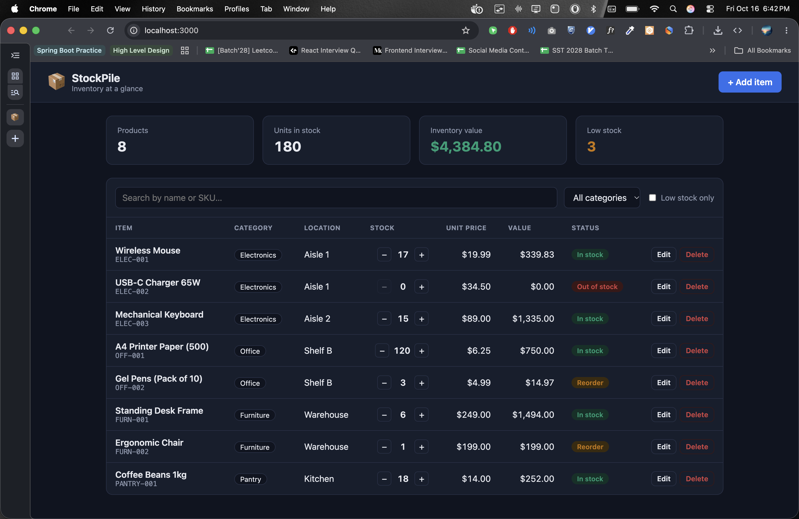 |
| **SS-04: API & Database Verification**<br>`curl` verification of `/health`, `/api/items`, `/metrics` and PostgreSQL database query. | 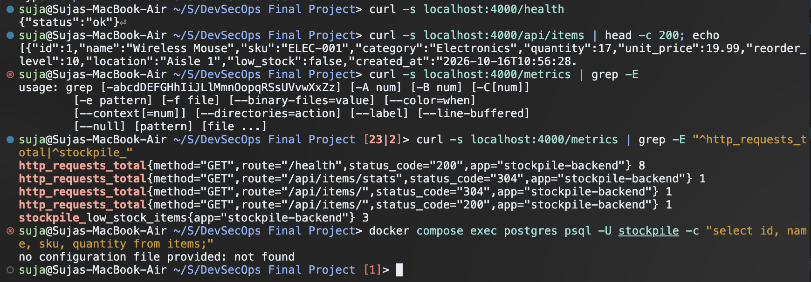 |

---

### 3.2 Git, CI/CD Pipeline & Security Scanning (M3, M5, M6)

| Milestone Verification | Screenshot Evidence |
| :--- | :--- |
| **SS-05: Git Commit History**<br>10+ semantic, structured commits representing logical project layers. | 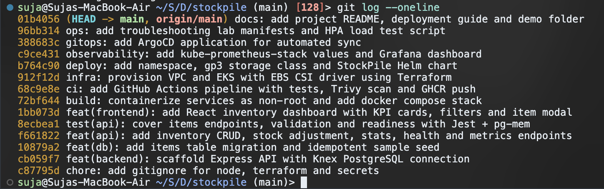 |
| **SS-06: GitHub Actions Workflow**<br>End-to-end green pipeline graph executing test, build, scan, and GitOps image bump. | 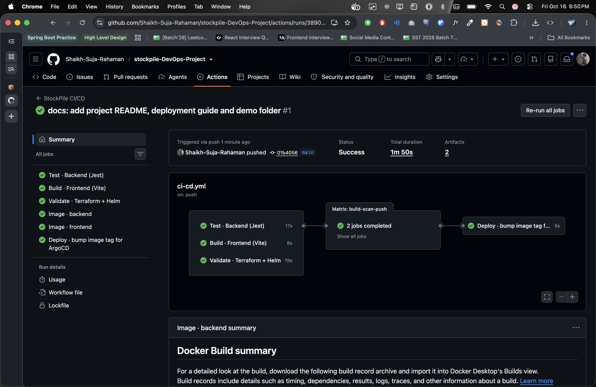 |
| **SS-07: CI Test Gate**<br>Expanded `Run tests` step in GitHub Actions showing tests blocking pipeline on failure. | 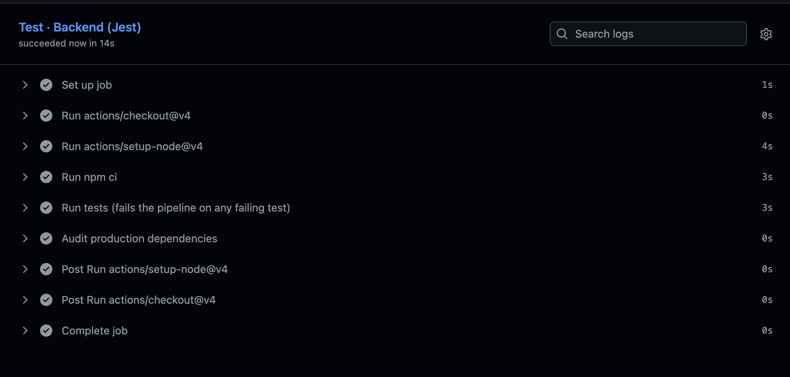 |
| **SS-08: Trivy Container Vulnerability Scan**<br>Security scan showing 0 HIGH and 0 CRITICAL vulnerabilities for both images. | 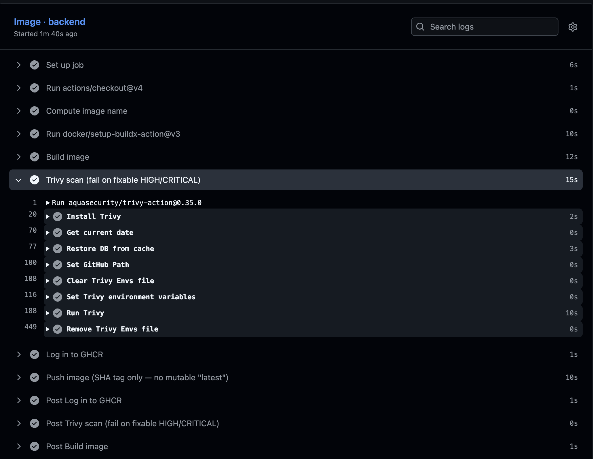 |
| **SS-09: GitHub Container Registry (GHCR)**<br>Public images on GHCR tagged immutably with the Git commit SHA (no mutable `latest`). | 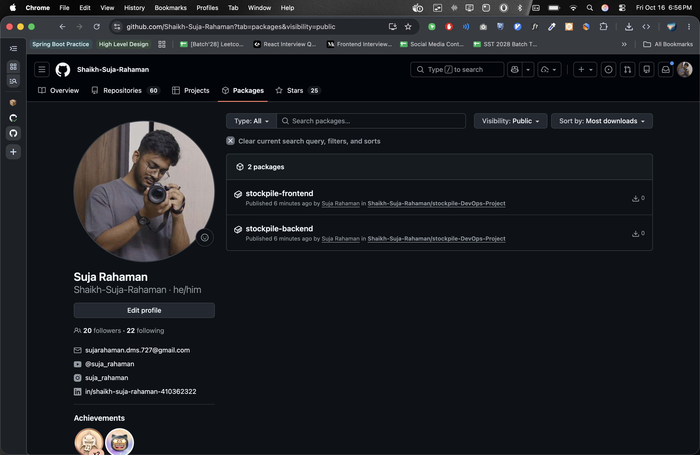 |

---

### 3.3 Infrastructure as Code via Terraform (M7)

| Milestone Verification | Screenshot Evidence |
| :--- | :--- |
| **SS-11: Terraform Plan**<br>Execution plan displaying 62 resources to add (VPC, Subnets, EKS, Node Groups, IAM). | 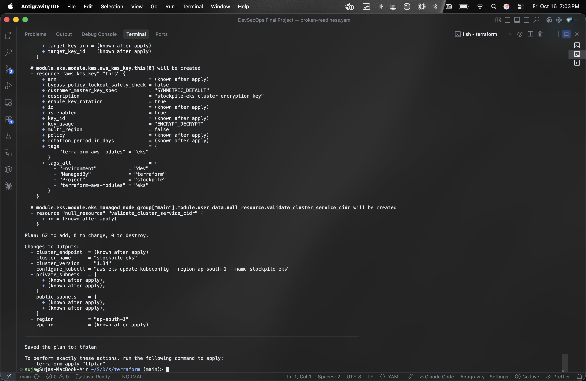 |
| **SS-12: Terraform Apply Complete**<br>Successful apply with outputs (`cluster_name`, `vpc_id`, `configure_kubectl`). | 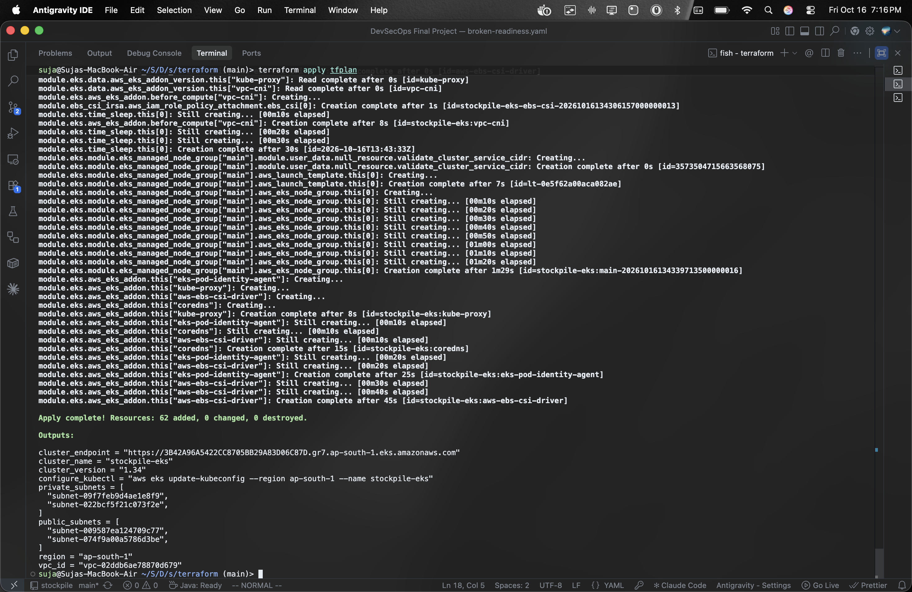 |
| **SS-13: AWS VPC & Subnets**<br>Verified 4 subnets (2 public + 2 private) spanning dual Availability Zones with NAT Gateway. | 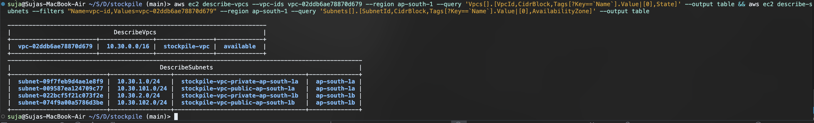 |
| **SS-14: AWS EKS Cluster & Managed Nodes**<br>Cluster `stockpile-eks` (v1.34) in `ACTIVE` state with 2x `t3.large` worker nodes in `Ready` status. | 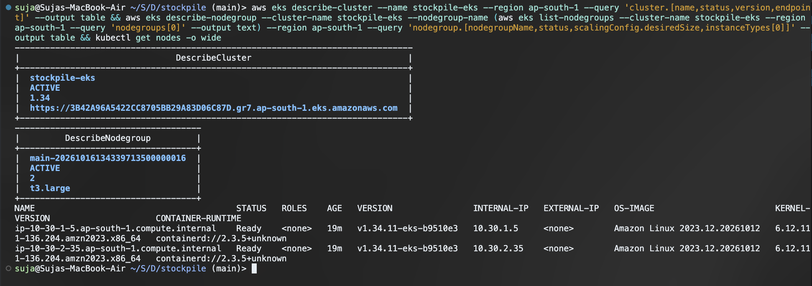 |

---

### 3.4 Kubernetes Deployment & Networking (M8)

| Milestone Verification | Screenshot Evidence |
| :--- | :--- |
| **SS-15: Pods Running**<br>All workload pods (`backend`, `frontend`, `postgres`) running and healthy in namespace `stockpile`. | 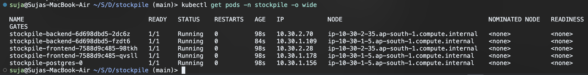 |
| **SS-16: Kubernetes Services**<br>Internal `ClusterIP` services for backend (`:4000`), frontend (`:80`), and PostgreSQL (`:5432`). | 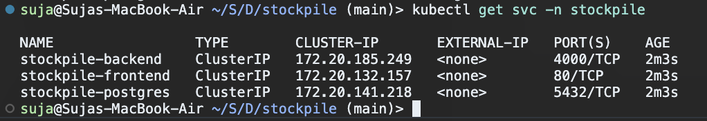 |
| **SS-17: Helm Release Status**<br>`helm list -n stockpile` showing status `deployed` with chart version `1.0.0`. | 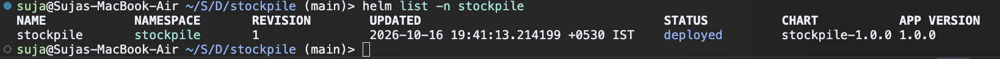 |
| **SS-18: Ingress Resource**<br>Ingress routing HTTP traffic through AWS Elastic Load Balancer (ELB). | 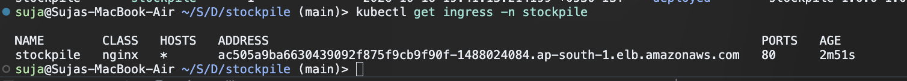 |
| **SS-19: Live Application on AWS**<br>Browser accessing StockPile live via the AWS ELB endpoint. | 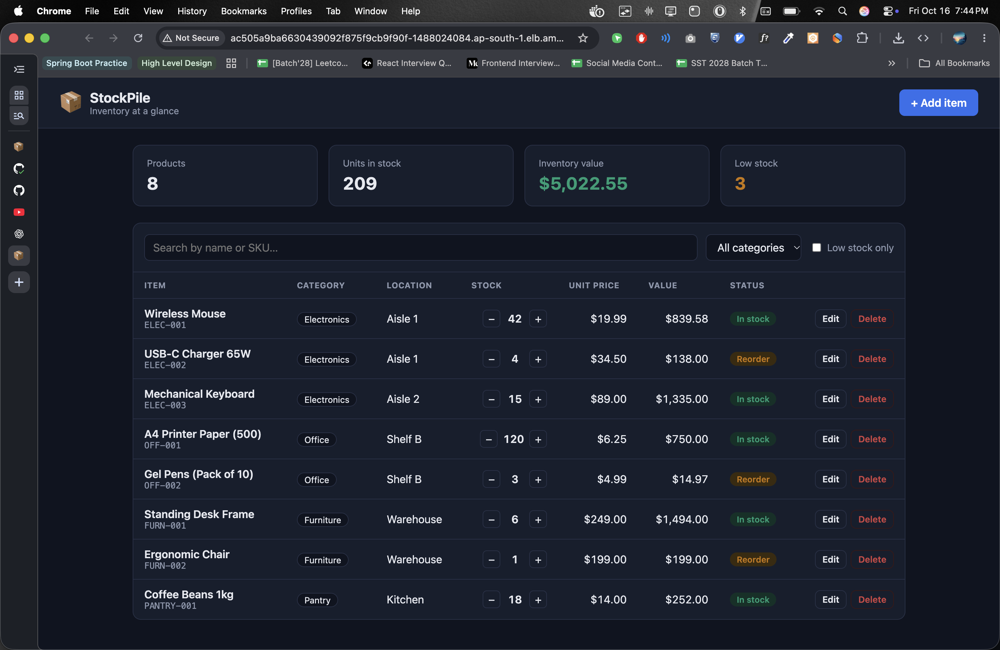 |
| **SS-20: Prometheus Metrics Endpoint**<br>Internal `/metrics` endpoint exposing standard process and custom business metrics. | 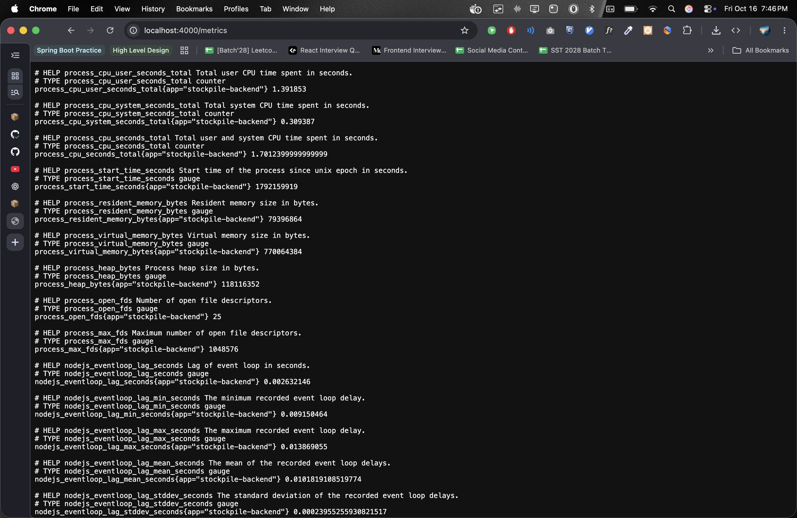 |

---

### 3.5 Autoscaling & Observability (M9)

| Milestone Verification | Screenshot Evidence |
| :--- | :--- |
| **SS-21: Horizontal Pod Autoscaler Scaling**<br>HPA detecting target load and scaling backend replicas from 2 to 4+ pods. | 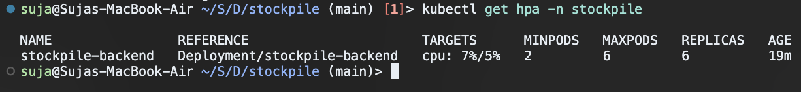 |
| **SS-22: Scaled Replicas in Cluster**<br>`kubectl get pods` demonstrating dynamic deployment expansion under load. | 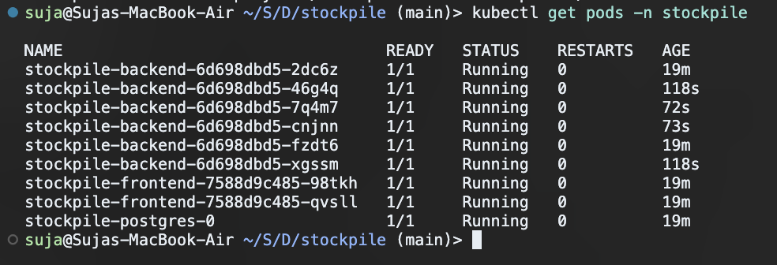 |
| **SS-23: Prometheus Targets UP**<br>Prometheus Operator `ServiceMonitor` scraping all backend instances with state `UP`. | 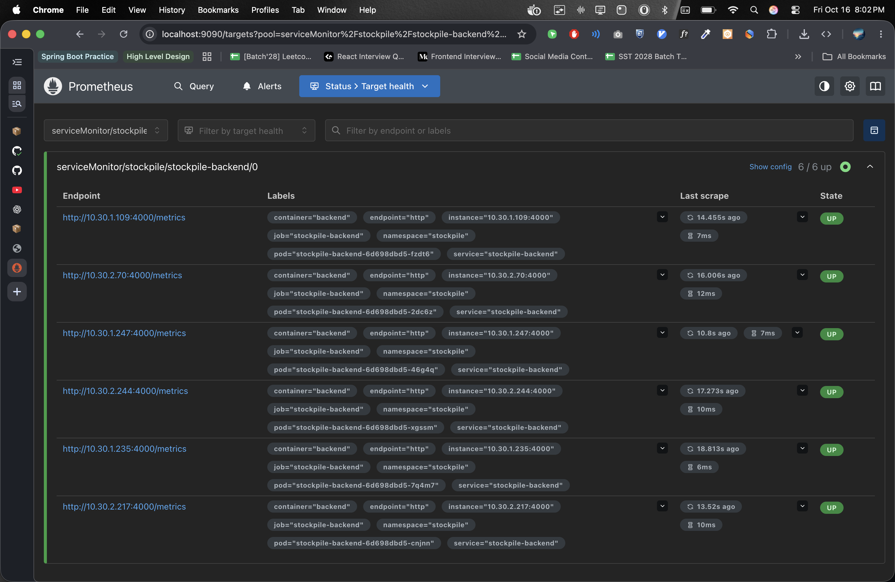 |
| **SS-24: Grafana StockPile API Dashboard**<br>Populated dashboard visualizing requests/sec, p95 latency, HTTP route distributions, and CPU usage. | 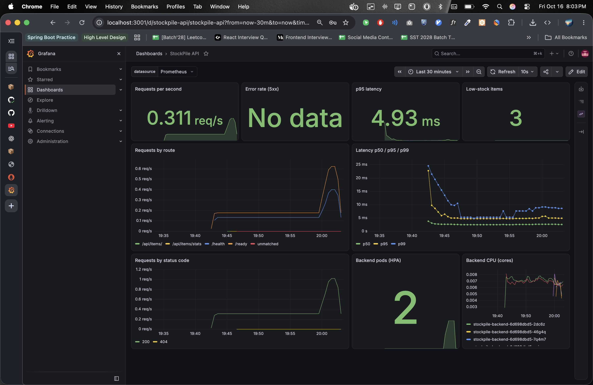 |

---

### 3.6 GitOps with ArgoCD (GitOps & Continuous Deployment)

| Milestone Verification | Screenshot Evidence |
| :--- | :--- |
| **SS-26: ArgoCD Application Tree**<br>Application tree in ArgoCD UI showing all resources in state `Synced` and `Healthy`. | 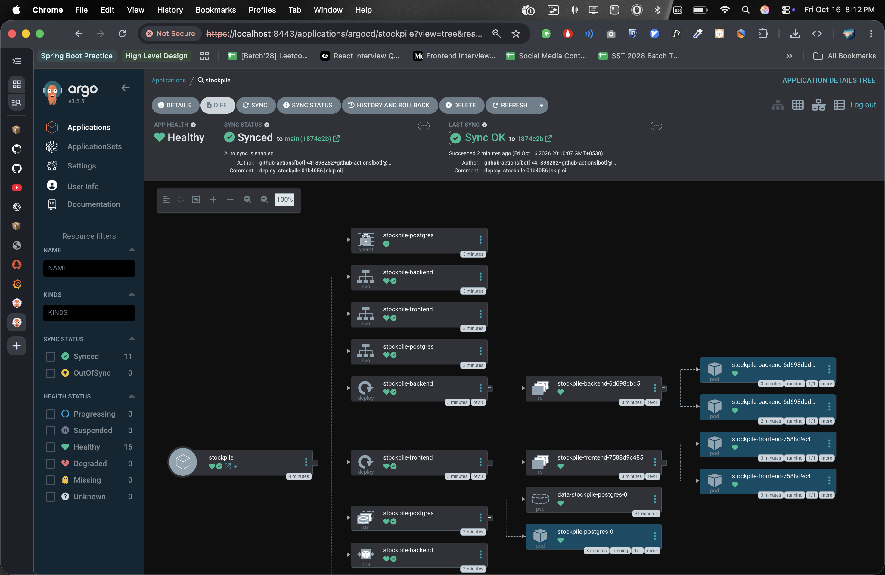 |
| **SS-27: Automated GitOps Rolling Update**<br>ArgoCD automatically synchronizing new commit SHA after code change and rolling pods zero-downtime. | 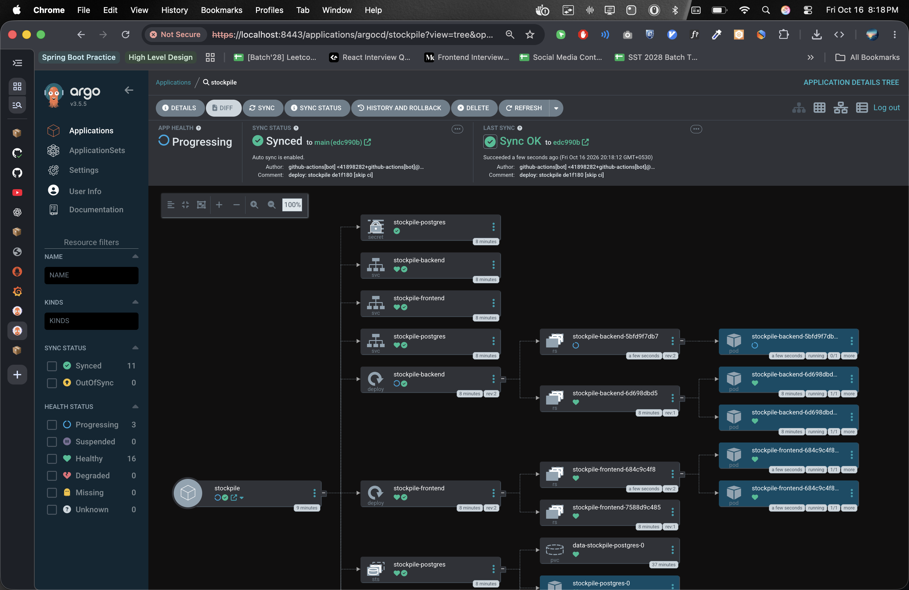 |

---

### 3.7 Troubleshooting & Teardown (M7, SRE)

| Milestone Verification | Screenshot Evidence |
| :--- | :--- |
| **SS-28: SRE Troubleshooting Lab**<br>Simulating and diagnosing Kubernetes failure states (`ImagePullBackOff`, missing endpoints, bad readiness probe). | 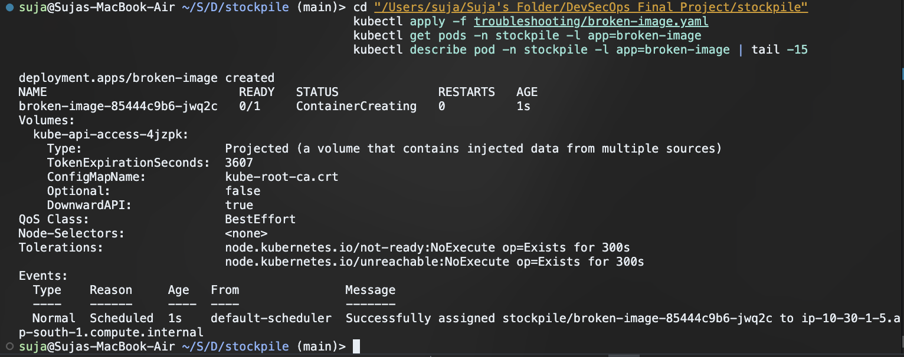 |
| **SS-29: Terraform Clean Teardown**<br>Execution of `terraform destroy` successfully deleting all 62 AWS cloud resources. | 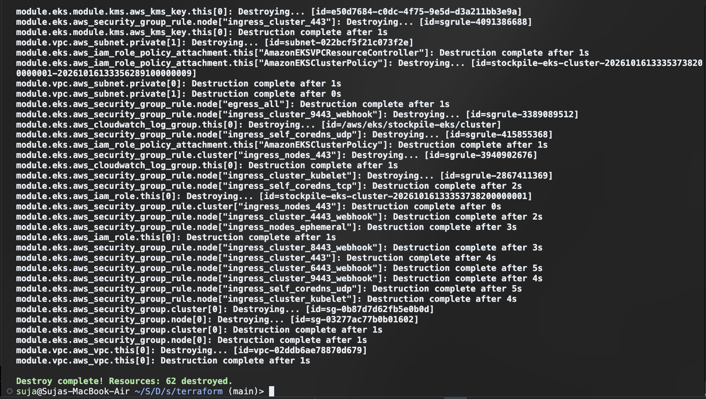 |

---

## 4. API Endpoints

The backend exposes RESTful endpoints with comprehensive JSON error handling:

| Method | Endpoint | Description |
| :--- | :--- | :--- |
| `GET` | `/health` | Liveness check (process running) |
| `GET` | `/ready` | Readiness check (database reachable) |
| `GET` | `/metrics` | Prometheus metrics export |
| `GET` | `/api/items` | List inventory items (supports `search`, `category`, `lowStock=true`) |
| `GET` | `/api/items/stats` | Aggregated statistics: total units, stock value, low-stock count |
| `GET` | `/api/items/:id` | Fetch single item details |
| `POST` | `/api/items` | Create new inventory item (validates uniqueness of SKU) |
| `PUT` | `/api/items/:id` | Update item attributes |
| `PATCH` | `/api/items/:id/stock`| Increment/decrement stock count with zero-floor validation |
| `DELETE`| `/api/items/:id` | Remove inventory item |

---

## 5. Security Architecture (DevSecOps)

- **Non-Root Execution:** All containers run as unprivileged users (`node:1000`, `nginx:101`).
- **Read-Only Filesystem:** Container root filesystems are mounted read-only, preventing runtime tampering.
- **Vulnerability Scanning:** Automated Trivy scanning in CI stops builds on fixable `HIGH` or `CRITICAL` CVEs.
- **Supply-Chain Hardening:** Pinned actions and base images protected against upstream CVE attacks (e.g., CVE-2026-33634).
- **Network Segmentation:** Kubernetes `NetworkPolicy` isolates PostgreSQL, permitting ingress traffic strictly from backend application pods.
- **Storage Security:** Encrypted `gp3` storage class with AWS KMS encryption for all persistent volumes.

---

## 6. How to Run Locally

### Fast Start (Docker Compose)
```bash
# Start PostgreSQL, Express Backend, and React Frontend
docker compose up --build

# Open the dashboard
open http://localhost:3000
```

### Run Automated Tests
```bash
cd backend
npm test
# Or for detailed output:
npx jest --verbose
```

---

## 7. License & Credits

Built as part of the **DevSecOps Final Capstone**. All infrastructure configurations, application source code, and deployment manifests are structured following cloud-native best practices.
